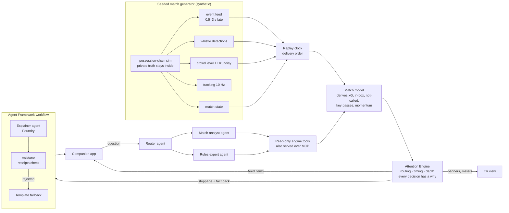

# Visual Match Intelligence

**Football's sound, made visible.** A hearing fan follows a match through the referee's whistle, the roar of the crowd and the commentator. Visual Match Intelligence turns those into calm visual signals on the screen, plus a companion app on the phone, for anyone with hearing difficulty. It does not replace captions or sign language; it covers what they leave out.

Built for the Microsoft *Inside the Game* hackathon. **All matches, teams and players are synthetic**, produced by our own seeded generator. No real footage, data, clubs or league marks are used.

| TV view (the broadcast) | Companion app (phone) |
|---|---|
| Source-driven **3D football replay**, skinned human athletes, locally licensed turf, an original stadium and a crowd driven by delivered crowd amplitude. Broadcast/full-pitch cameras, shadows and a low-power setting. Two identical **atmosphere edge bars**, one **round event marker** and **momentum** under the score. Presenter diagnostics stay outside the viewing area. Labelled 2D fallback if WebGL2 is unavailable. | **One match chat** with two voices: **Kai** (commentator) calls goals, VAR, cards and subs as facts; **Ada** (analyst) adds stoppage analysis in 2–3 sentences with receipts, replying to the moment it explains, and stays quiet otherwise. Ask either of them about this match, the rules, stats and tactics; code picks who answers. No notifications. Two depth levels from a 3-question onboarding. |

## Run it

```bash
python -m pip install -r requirements-lock.txt
uvicorn vmi.api.server:app --reload
# open http://localhost:8000 → TV view on a laptop, Companion on a phone (same room code)
pytest -q
```

It runs fully offline: without Foundry settings, the agents fall back to deterministic local implementations with the same tools and receipts. To use Microsoft Foundry, set `FOUNDRY_PROJECT_ENDPOINT` and `FOUNDRY_MODEL` and sign in with `az login` (keyless, Entra ID).

## How it works



**Deterministic numbers, AI for words.** Code decides what happened, what to show and when. The Foundry agents only word it, from a fact pack in which every fact has an event ID. A validator rejects any sentence whose evidence, numbers or names are not in the pack, or that claims *why* the crowd reacted (the sensor measures loudness only). On rejection or any agent error, a template writes the card, so the fan always gets a correct text. Every card and answer shows its receipts.

**The Attention Engine** decides routing, timing and depth. In a typical generated match, about 1,550 feed and whistle records arrive; about 50 become banners, 30–40 become feed items and 7–11 become analysis cards, and the rest are left out with a reason. The TV view shows this trace live.

**Data realism.** The generator emits only what real sources produce today: an operator-logged event feed (fouls only when awarded, VAR phases, no xG), whistle detection from audio (no reason), a relative crowd level (no mood) and optical tracking. Everything interpretive is derived by the engine. Details: [docs/spec.md §6](docs/spec.md).

## Repository map

| Path | What |
|---|---|
| `docs/spec.md` | Build spec: surfaces, Attention Engine rules, momentum formula with a worked example, data realism |
| `vmi/generator/` | Seeded match generator and tracking frames |
| `vmi/engine/` | Match model and derivations, Attention Engine, fact packs, replay clock |
| `vmi/agents/` | Explainer workflow, Ask agents (router, analyst, rules), read-only tools, rules knowledge base |
| `vmi/mcp_server.py` | The engine tools as an MCP server (`python -m vmi.mcp_server`) |
| `vmi/api/server.py` | FastAPI app, rooms, WebSocket push, demo warm-up cache |
| `web/` | TV view and companion app (no build step) |
| `prompts/` | Agent instructions |
| `infra/deploy.sh` | Azure Container Apps + Application Insights + managed identity to Foundry |
| `tests/` | Generator realism, engine routing, validator and workflow fallback, API |

## Deploy to Azure

`infra/deploy.sh` builds the container on Azure Container Apps, adds Application Insights (OpenTelemetry), gives the app a managed identity with the *Azure AI User* role on the Foundry resource (no keys), and runs one replica so the judging link has no cold start.

## Status

The D1-04 task branch includes skinned athletes, CC0 turf maps and source-driven crowd motion; PR #12 remains under review with physical integration and visual-reference acceptance open. A previous LIVE baseline exceeded 30 FPS on the documented test machine, but does not certify newer graphics. See [implementation, licenses and evidence](docs/implementation/D1-04-MATCH-3D.md). Crowd motion illustrates delivered amplitude, without inferring emotions or independently validating the atmosphere formula. The merged D1 baseline includes generator v2, atmosphere, momentum, accessibility signals and causal-clock fixes. Current Developer 2 model and deployment status is recorded in the [model decision](docs/implementation/11-MODEL-DECISION.md) and [D2 handoff](docs/implementation/HANDOFF-D2.md). No extra-cost service is authorized.
