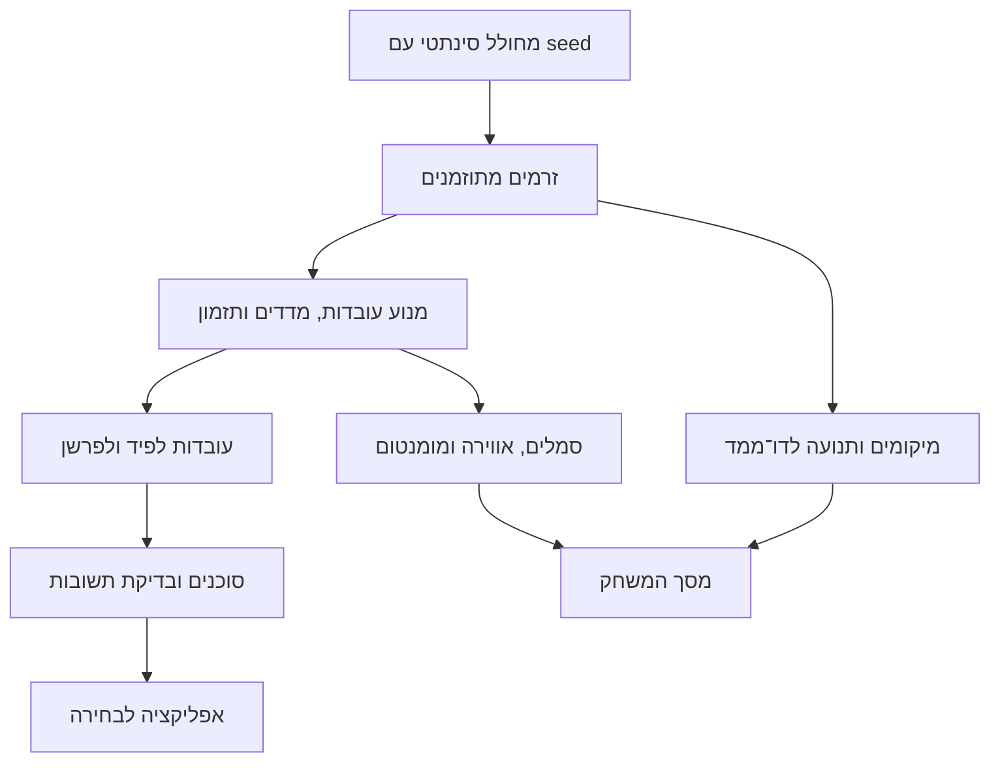

# VMI — תוכנית עבודה סופית לשני מפתחים ולכלי הבינה שלהם

תאריך עדכון: 23 באוקטובר 2026.

מסמך זה שומר את כל 12 תחומי התוכנית הקודמת, ומשלב בגוף הסעיפים את דרישת אפס העלות ואת ההחלטות האחרונות: דו־ממד לדמו, אירוע xG מאוחר ומקושר, עצירות וחידושים מפורשים, דריבלים, יד, כרטיסים מקושרים והפסקת שתייה. בחירת מודל ה־AI ודרך הפעלתו נשארת החלטה פתוחה ומכרעת, לבקשת הצוות. היא המשימה הראשונה של מפתח 2, לפני בחירת ספק או בניית חיבור קבוע. מסמך זה הוא תוכנית לביצוע, ולא דיווח שהמוצר כבר מומש או נבדק.

## 1. התוצאה שאנחנו בונים

דמו של משחק כדורגל סינתטי בדו־ממד, עם שכבת נגישות שמאפשרת לצופה להישאר ממוקד במשחק:

- שני פסי אווירה דקים בצמוד לדפנות המסך.
- סמלי אירועים עגולים, ברורים ואיכותיים.
- מד מומנטום ליד לוח התוצאות.
- אפליקציה נלווית לבחירה: פיד, פרשן אישי, שאלות וכפתור **“What did I miss?”**.
- מחולל משותף שמייצר משחק עקבי, מגוון וניתן לשחזור.
- הפרדה בין נתונים גולמיים, חישובים דטרמיניסטיים וניסוח באמצעות AI.

**המשחק והעובדות דטרמיניסטיים; ניסוח הפרשן יכול להשתנות.** אותו seed ואותה גרסת מחולל יפיקו אותם אירועים ומיקומים. מודל השפה לא יחליט על תוצאת משחק, רמת אווירה או הצגת סמל.

ההנחיות למפתחים יהיו בעברית. הקוד, שמות הקבצים, הממשק, הפרשן וחומרי ההגשה יהיו באנגלית.

הדמו הנוכחי נשאר בדו־ממד ומשדרג את התצוגה הקיימת: מגרש מלוטש, שחקנים וכדור מובחנים ותנועה רציפה. תמונת ההמחשה היא כיוון עיצובי לשכבת הנגישות, ולא הבטחה לפוטוריאליזם. תלת־ממד נדחה להמשך ואינו תנאי להגשת הדמו.

### בסיס העבודה

נמשיך מהקוד שבזיפ ונשדרג אותו. “מאפס” מתייחס להוראות ההקמה והעבודה, ולא למחיקת המימוש הקיים.

לפני פיתוח, נשווה את הזיפ ל־GitHub ונקבע commit בסיס משותף. הבדיקה הנוכחית מבוססת על הזיפ, ולא על אימות של מצב הריפו המרוחק. תיקיית `source-review` היא עותק לעיון; אין להניח שהיא checkout פעיל של הריפו.

### תנאי מחייב: אפס תשלום נוסף

- אין רכישת מנויים, חומרה, מודלים, נכסים, דומיין או שירותי ענן לצורך הפרויקט.
- אין הזנת אמצעי תשלום, התחלת ניסיון שמתחלף לחיוב, הפעלת חריגות בתשלום או הסתמכות על זכירה לבטל שירות.
- מסלול חינמי מוגבל קביל רק אם תנאיו מתאימים לשימוש ואין מעבר אוטומטי לחיוב. בסיום המכסה עוצרים את הקריאות או מציגים גיבוי שקוף.
- קרדיטים והטבות האקתון אינם נחשבים תקציב מאושר. מפתח 2 רשאי לבדוק אותם, אך לא להפעיל משאבים לפני אימות שאין אפשרות לחיוב ושמשך הזמינות מתאים לשיפוט.
- משתמשים במחשבים ובגישות הקיימים. אין הבטחה שלמודל מקומי יהיו ביצועים מספקים לפני בדיקה על החומרה בפועל.
- אם אין חלופה שעומדת גם באיכות וגם באפס עלות, מסמנים חסם לצוות. לא משדרגים, לא מחייבים ולא מציגים תשובות מוכנות כ־AI חי.

---

## 2. חבילת מסמכי ה־MD

תיקיית העבודה למסמכים היא `docs/implementation/`. המסמך הראשי הנוכחי הוא `VMI-FINAL-PLAN-F.md`; מסמכי הנושאים מרכזים את הסעיפים המתאימים ממנו, וקובצי הביצוע יורחבו עם עובדות שיתבררו בהקמה. תוכנית אינה אישור שהמשימות הושלמו. נוהל האיכות המפורט כבר נכתב ב־[12-QUALITY-AND-GIT-GATES.md](12-QUALITY-AND-GIT-GATES.md); שאר החבילה תיווצר במסגרת משימות ההקמה.

| קובץ | התוכן |
|---|---|
| `00-START-HERE.md` | מה בונים, סדר קריאה, מילון מושגים, איך מתחילים ואיך בוחרים את המשימה הבאה |
| `01-PRODUCT-DECISIONS.md` | כל ההחלטות מהמסמך בן ששת העמודים ומהשיחה; הבחנה בין קיים, מתוכנן ורעיונות להמשך |
| `02-SETUP-AND-GIT.md` | התקנה, שיבוט, הרשאות, סודות, עבודה מקומית ובסביבת פיתוח בענן רק ללא עלות נוספת, branches, commits, PRs ופתרון התנגשויות |
| `03-ARCHITECTURE-AND-CONTRACTS.md` | זרימת הנתונים, בעלות על רכיבים, שעון המשחק, חוזי קלט ופלט ומדיניות שינוי שלהם |
| `04-SHARED-GENERATOR.md` | מפרט המחולל, תנועה, אירועים, רעש, השהיות, תרחישים, שחזור ובדיקות איכות |
| `05-DEVELOPER-1.md` | משימות מדורגות למפתח 1: מחולל, מנוע, דו־ממד ושכבת הנגישות |
| `06-DEVELOPER-2.md` | משימת ההכרעה הראשונה; API, אפליקציה, סוכנים ותפעול; Azure כחלופה מותנית בלבד |
| `07-INTEGRATION-AND-QA.md` | חיבור החלקים, בדיקות חוזה, בדיקות משתמש־מול־מערכת, ביצועים ותנאי קבלה |
| `08-DEMO-AND-SUBMISSION.md` | תסריט הדגמה, סרטון, README ציבורי, קישור לשופטים ורשימת הגשה |
| `09-AI-WORK-PROMPTS.md` | פרומפט פתיחה לכל מפתח, פרומפט לכל חבילת עבודה, ביקורת והעברת הקשר |
| `10-WORK-BOARD.md` | מצב המשימות, בעלים, תלות, branch, PR, בדיקות, חסמים והמשימה הבאה |
| `11-MODEL-DECISION.md` | ההחלטה המכרעת שנותרה פתוחה: יתרונות וחסרונות, בדיקות השוואה, תנאי אפס עלות ותוצאת ההכרעה |
| [`12-QUALITY-AND-GIT-GATES.md`](12-QUALITY-AND-GIT-GATES.md) | נוהל מחייב לכל branch ולמעבר שלב: unit tests, ביקורת קוד, הכרעה טכנית מתועדת, ניהול Git, CI, ראיות ויומן למידה |

### המבנה הקבוע של כל משימה

כל משימה תקבל מזהה, למשל `D1-04`, ותכלול:

1. מטרה והתנהגות צפויה.
2. מה כבר קיים ומה צריך לשנות.
3. מסמכים וקוד שחייבים לקרוא.
4. תלויות ומשימות שחייבות להסתיים קודם.
5. בעלים וגבולות אחריות.
6. שם branch מוצע.
7. צעדי מימוש ותתי־משימות.
8. דוגמאות קלט ופלט כשיש שינוי התנהגות.
9. בדיקות ותנאי סיום מדידים.
10. מה להציג לשותף בביקורת.
11. פרומפט מוכן לכלי הבינה.
12. הוראות עצירה במקרה של סתירה או חסם.

לא נסמן משימה כגמורה רק משום שנוצר קוד. היא מסתיימת לאחר בדיקה, תיעוד, סקירת קוד טכנית, מיזוג ואימות המצב המשולב. בכל משימה ובכל branch חלים שערי B0–B4 שבנוהל האיכות, גם אם אינם חוזרים ברשימת המשימה: בדיקות יחידה וסקירת diff אחרי שינוי התנהגות משמעותי, חבילה מלאה וביקורת לפני מיזוג, בדיקה מחודשת אחרי תיקון או סנכרון ואימות `main` לאחריו. מפת בדיקות ייעודית לכל D1/D2 נמצאת בנוהל. אין מעבר לתת־שלב תלוי כשבדיקה או ממצא חוסם נשארו פתוחים.

---

## 3. חלוקת העבודה

| תחום | מפתח 1 | מפתח 2 |
|---|---|---|
| החלטת מודל והפעלה — ראשונה ומכרעת | בודק את תוצאות האיכות ואת השפעת העומס על המשחק | מוביל את D2-00 ומציג הכרעה מנומקת לצוות |
| חוזי נתונים | מאשר צרכים של המחולל והמסך | מרכז ומתחזק את החוזים |
| המחולל המשותף | בעלים | בודק התאמה לאפליקציה ולסוכנים |
| מנוע המשחק והמדדים | בעלים | צורך עובדות ומספק מקרי בדיקה |
| שעון, חדרים ותקשורת | מגדיר צורכי סנכרון | בעלים |
| דו־ממד ושכבת נגישות | בעלים | מבצע ביקורת חוויית משתמש |
| אפליקציה ותקצירים | בודק התאמה לאירועים | בעלים |
| סוכנים ו־AI | בודק נכונות עובדות | בעלים |
| CI, אירוח ותפעול | מספק בדיקות ביצועים | בעלים; ענן רק אם עובר את תנאי אפס העלות |
| סרטון והמחשות | מוביל צילום הדמו | מוביל תסריט והסבר הסוכנים |
| בדיקת הגשה | שניהם | שניהם |

המחולל הוא **רכיב משותף עם בעלים אחד**, ולא שני מחוללים נפרדים. מפתח 2 יוכל לפתח נגד תרחישים מוקלטים ומאומתים בלי להמתין לסיום הדו־ממד.

האיזון נעשה לפי מורכבות ותלויות, לא לפי מספר קבצים. לאחר החיבור הראשון תיבחן העברת משימות עצמאיות בין המפתחים, בלי לפצל בעלות על אותו רכיב באמצע שינוי.

### מבנה טכנולוגי

- ממשיכים עם Python ו־FastAPI.
- שומרים על ממשק WebSocket משותף למסך ולאפליקציה.
- ממשיכים עם תצוגת הדו־ממד הקיימת; אין תלות חדשה ב־Three.js לצורך הדמו.
- משמרים כלי build וניהול חבילות רק כאשר הם נחוצים למימוש הקיים. אין להוסיף npm רק עבור תלת־ממד שנדחה.
- משמרים את ממשקי JavaScript הקיימים; לא מוסיפים מעבר ל־React שאינו נחוץ למטרה.
- גרסאות ננעלות לאחר בדיקת תאימות. לא מסתמכים על הורדת ספריות מ־CDN בזמן ההדגמה.
- ספק המודל ודרך הפעלתו אינם ננעלים כאן. בונים שכבת חיבור נפרדת, כדי לא לקשור את הפיד והמשחק לספק שטרם נבחר.

אם יוחלט בעתיד על תלת־ממד, תיבחן Three.js בנפרד. ההחלטה אינה מוסיפה כעת התקנות או עבודה לדמו.

### מילון קצר למפתחים בתחילת הדרך

| מונח | פירוש ותפקיד אצלנו |
|---|---|
| Python | שפת הקוד של המחולל, החישובים והשרת הקיים |
| FastAPI | ספריית Python שמחברת את הדפדפן למנוע; אפשר להריץ על המחשב, ללא שירות אירוח בתשלום |
| WebSocket | חיבור מתמשך שמעדכן את המשחק והטלפון בלי לרענן את הדף |
| Three.js | ספרייה לתלת־ממד בדפדפן; נדחתה ואינה נדרשת לדמו הדו־ממדי |
| npm | כלי להתקנה וניהול של רכיבי קוד; לא נדרש אצלנו מנוי לחבילות פרטיות |
| build | הכנת קובצי האפליקציה להפעלה והפצה |
| seed | מספר התחלתי שמאפשר ליצור שוב את אותו משחק |
| fixture | קלט בדיקה קבוע ששני המפתחים מריצים מולו |
| branch | מסלול עבודה נפרד ב־Git |
| commit | נקודת שמירה מתועדת של שינויים |
| PR | בקשה לבדוק ולמזג את השינוי לריפו המשותף |
| CI | בדיקות אוטומטיות לשינויים; יש לוודא שמסלול ההרצה שנבחר אינו מחויב |
| API / SDK | ממשק שמאפשר לקוד להשתמש ברכיב אחר / חבילת כלים לחיבור אליו |
| Agent Framework | רכיב Microsoft לתזמור סוכנים; אינו זהה למודל או למנוי ענן |
| Ollama | תוכנה להפעלת מודלים; נבחן שימוש מקומי בלבד ללא שירותי ענן |

---

## 4. הבסיס המשותף: חוזים, זמן ונתונים

### זרימת המערכת



### חוזי המידע

נגדיר סכמות ודוגמאות תקינות עבור:

| חוזה | תוכן |
|---|---|
| אירוע | מזהה, משחק, זמן התרחשות, זמן מסירה, סוג, קבוצה, שחקן ושדות האירוע |
| מעקב | מיקום הכדור, גובהו, שחקנים פעילים, כיוון ותנועה, מצב החזקה ואיכות המדידה |
| קהל | עוצמה יחסית 0–1, זמן ואיכות; בלי “רגש הקהל” כעובדת קלט |
| מצב משחק | מחצית, שעון, תוצאה ידועה, כדור במשחק, כיוון ההתקפה, עצירה פעילה וחידוש ממתין |
| אנליטיקה מאוחרת | אירוע `shot_xg` עם `shot_id`, ערך סינתטי וזמני חישוב ומסירה |
| החלטות וחידושים | טריגר, עצירה, החלטת שופט, כרטיס וחידוש; קשרים מפורשים בין האירועים |
| מדדים | אווירה, רכיב קהל, רכיב התקפה, מומנטום והסבר חישובי |
| סימון אירוע | מזהה יציב, סוג, תווית, תזמון, עדכון והפניות לעובדות |
| חבילת עובדות | עובדות שהגיעו עד נקודת זמן מוגדרת, עם מזהי מקור |
| תקציר | תחילת חלון, סוף חלון, אירועים מכוסים ותוצאה מאומתת |

הסכמות הן חוזה פנימי של VMI. לא נציג אותן כתקן רשמי של ההאקתון או כתאימות מלאה לספק נתונים חיצוני.

### קישור אירועים ושמירת הקשר

מזהי האירועים ייחודיים בתוך `run_id`. נוסיף קשרים מפורשים לפי סוג האירוע: `shot_id`, `trigger_event_id`, `stoppage_id`, `decision_id`, `restart_id`, `possession_id` ומזהה המסירה שהכינה בעיטה. אין לשייך מידע לפי קרבת זמן בלבד.

אירוע שמגיע לפני המקור שלו ממתין במאגר קישורים מוגבל של ההרצה. כפילות לפי מזהה אינה מעובדת פעמיים. בעת seek/reset המאגר נבנה מחדש רק מנתונים שנמסרו עד נקודת הצפייה. מקור שלא התקבל נשאר חסר; לא משייכים לאירוע אחר. בסיום הרצה קישורים חסרים מתועדים ונמחקים עם ההרצה.

המחולל שומר מצב אמת פנימי לציור המשחק. מנוע הפרשנות מקבל רק דיווחים שנמסרו, כולל השהיות, ולא את תוצאתו העתידית של המהלך. `play_context` מתאר מקור מהלך (משחק פתוח, קרן, בעיטה חופשית או פנדל), בנפרד מ־`ball_in_play`: לאחר ביצוע קרן הכדור יכול להיות במשחק ועדיין לשאת קישור לקרן.

### החלטות זמן וסנכרון

- זמן הסימולציה מונוטוני; שעון הכדורגל נגזר ממנו.
- מבחינים בין **מתי אירוע קרה** לבין **מתי המערכת קיבלה אותו**.
- הפירוש והסוכנים משתמשים רק בנתונים שכבר נמסרו.
- כל שינוי seed או מעבר בזמן מייצר מזהה הרצה חדש, `run_id`.
- תשובה אסינכרונית מהרצה קודמת נזרקת.
- מעבר בזמן מנקה סמלים זמניים ובונה מחדש את מצב המסך והפיד.
- השהיית ניגון (`pause`) מקפיאה את הסימולציה ואת חיי הסמלים. עצירת כדורגל אינה pause: זמן הסימולציה ממשיך, הכדור מחוץ למשחק וחיי הסמלים ממשיכים להיספר.
- תקשורת שנקטעת מסומנת כניתוק; לא ממשיכים להמציא מהלכים.
- חיבור מחדש מקבל תמונת מצב עדכנית לפני חזרה לעדכונים.

### מניעת ידיעה מראש

פרטי סוף המשחק, תוצאה סופית ופרקי דמו עתידיים לא יישלחו למנוע הפרשנות או לאפליקציה בזמן צפייה.

בחירת פרקי דמו תהיה חלק מבקרת מציג נפרדת. הסוכן לא יקבל גישה למחולל או לייצוא משחק מלא כדי לענות על שאלה על הרגע הנוכחי.

### חיבור למודל בלי לנעול ספק

שכבת החיבור תקבל שאלה או בקשת הסבר, snapshot, פרופיל והגבלת זמן; היא תחזיר טקסט, הפניות לעובדות ומצב ביצוע. מידע על ספק/מודל, שימוש בגיבוי ושגיאות יישמר לצורכי בדיקה. הממשק יאפשר את החלופה שתיבחר ב־D2-00 בלי לשנות את חוזי המשחק. עד ההכרעה אפשר לפתח מול גיבוי תבניתי מסומן, שאינו מוצג כאילו המודל כבר עובד.

---

## 5. המחולל: קצב גבוה, אמינות ושחזור

### שלושה קצבים שונים

| שכבה | יעד ראשוני |
|---|---|
| אירועי כדורגל | לפי התרחשות הגיונית במשחק |
| מעקב שחקנים וכדור | 20 דגימות לשנייה |
| קהל | דגימה אחת לשנייה |
| מצב משחק | בכל שינוי |
| ציור הדו־ממד | שאיפה ל־60 פריימים בשנייה, עם יעד קבלה בסיסי של 30 |

אלו יעדי הנדסה, לא דרישות רשמיות או נתוני ביצועים שכבר הושגו.

### מבנה המחולל

המחולל יפריד בין:

1. **מצב המשחק הפנימי:** מי מחזיק, מי פעיל, מהלך נוכחי, כדור חי או עצור.
2. **תכנון המהלך:** מסירה, נשיאה, בעיטה, איבוד או עצירה.
3. **מסלול התנועה:** תנועה רציפה של הכדור והשחקנים.
4. **תוצאת המהלך:** נקבעת בתוך הסימולציה.
5. **הזנת המערכת:** אירועים, מעקב וקהל עם השהיה ורעש מוגדרים.

אין ליצור תנועת כדור שאינה תואמת למסירה, או להצמיד את הכדור לשחקן שכבר מסר אותו.

### כיסוי אירועים

- פתיחת משחק, מחצית וסיום.
- מסירה מוצלחת וכושלת, נשיאה, דריבל מול מגן מזוהה, איבוד, חטיפה ותיקול.
- בעיטה, חסימה, הצלה, החטאה ושער.
- כדור חוץ, קרן, בעיטת שוער ובעיטה חופשית.
- עבירה כולל יד, נבדל, החלטת פנדל, כרטיסים נפרדים ומקושרים וחילוף.
- עצירה עם טריגר וסיבה, חידוש שנקבע וחידוש שבוצע, והפסקת שתייה.
- אנליטיקת xG מאוחרת המקושרת לבעיטה מסוימת.
- בדיקת VAR והכרעה לצורך הפיד וההקשר.
- משחק שקט, קהל חזק, לחץ ללא בעיטה והתקפה ללא תגובת קהל משמעותית.

לא כל משחק חייב לכלול כל אירוע נדיר. כיסוי מלא יושג באמצעות תרחישי בדיקה ייעודיים.

### בעיטה, תוצאה ו־xG מאוחר

1. `shot` מדווח על ביצוע בעיטה, ללא xG וללא תוצאה שטרם ידועה.
2. תוצאת הבעיטה מדווחת בנפרד לאחר התרחשותה ומקושרת באמצעות `shot_id`.
3. `shot_xg` נוצר ברכיב האנליטיקה הסינתטי של המחולל ונמסר לאחר השהיה. הוא מקושר לאותה בעיטה בדיוק.

ברירת המחדל להשהיית חישוב xG היא 2–5 שניות סימולציה מהבעיטה, ניתנת להגדרה ולשחזור לפי seed. זוהי בחירת הדמיה, לא מדידה של ספק אמיתי. ערך xG נגזר מתמונת המצב לפני תוצאת הבעיטה; הצלחה או החטאה אינן משנות אותו. מתעדים גרסת שיטת האומדן ולא מציגים אותו כמודל מכויל.

המנוע מקבל את הערך ואינו מחשב אותו מחדש. xG נצרך באפליקציה בלבד, אינו נכנס לאווירה או למומנטום ואינו מוצג במסך המשחק.

דוגמת קישור מקוצרת (בנוסף למעטפת המשחק וההרצה):

```json
{"id":"shot_014","type":"shot","t":1268.4,"delivered_t":1269.2,"player_id":"H9","location":[94,32]}
{"id":"xg_014","type":"shot_xg","t":1272.0,"delivered_t":1272.3,"shot_id":"shot_014","xg":0.24,"source":"synthetic_analytics"}
```

ב־`shot_xg`, הזמן `t` הוא מועד זמינות תוצאת האנליטיקה; זמן הבעיטה נשמר באירוע המקושר. כל שאלה ותקציר משתמשים רק באנליטיקה שכבר נמסרה עד ה־snapshot שלהם.

### עצירה, החלטת שופט וחידוש

הרצף הוא **טריגר → עצירה → סיבה/החלטה → חידוש שנקבע → חידוש שבוצע**. הטריגר יכול להיות שריקה, יציאת כדור או הוראת עצירה מפורשת. קרן אינה מחייבת המצאת שריקה.

`play_stopped` כולל מזהה עצירה, זמן, קישור לטריגר וסיבה ידועה או `unknown`. החלטה מאוחרת מעשירה את אותה עצירה. `ball_in_play` הוא מצב נגזר מדיווחי העצירה והחידוש, ולא הסבר בפני עצמו. כדור נייח, מעקב חסר או עבירה עם יתרון אינם עוצרים משחק אוטומטית.

החלטה על קרן, בעיטה חופשית או פנדל מגדירה חידוש ממתין; רק דיווח ביצוע מפורש מחזיר את הכדור למשחק. בבעיטה חופשית ישירה, אירוע החידוש ואירוע הבעיטה מתארים אותה פעולה מקושרת: בעיטה אחת ואנימציה אחת.

המחולל מפסיק מהלך פעיל במצב האמת בעת העצירה. מנוע הנגישות מגיב כאשר העדות נמסרת אליו. אין לחשוף לו את סיבת העצירה לפני קבלתה.

### פנדל, יד וכרטיס נלווה

פנדל דורש `referee_decision` מפורש המקושר לעבירה ולעצירה; מיקום ברחבה הוא בדיקת עקביות בלבד. נגיעת יד שנפסקה כעבירה מדווחת כ־`handball`; אין להסיק שכל מגע ביד הוא עבירה.

כרטיס הוא אירוע עצמאי עם שחקן, צבע וקישור לעבירה/החלטה. פנדל אינו יוצר כרטיס אוטומטי. כרטיס מאוחר יכול להתווסף לאותה התרחשות. החלטה מתקנת מצביעה להחלטה שהוחלפה, וצרכני המידע משתמשים בהחלטה התקפה.

### נשיאה ודריבל

`carry` הוא התקדמות עם הכדור. `dribble` הוא ניסיון מעבר מול מגן מזוהה, עם תוקף, מגן, מיקומי התחלה וסיום והחזקה מקושרת. המחולל בונה את התנועה והמפגש; דיווח התוצאה נמסר רק לאחר הכרעת המהלך.

| תוצאה | משמעות בדמו |
|---|---|
| `complete` | מעבר המגן תוך שמירת שליטה |
| `failed` | איבוד או הדיפה שהכשילו את ניסיון המעבר |
| `interrupted` | מהלך שנקטע, למשל בעבירה מקושרת |
| `unresolved` | אין הכרעה ברורה, למשל כדור שנותר חופשי |

בודקים שהשחקנים פעילים, שהייתה החזקה מתאימה ושהמסלול והשליטה אחרי המפגש תואמים לתוצאה. התקדמות בקואורדינטות לבדה אינה דריבל מוצלח. זיהוי מתוך וידאו או סיווג אוטומטי ממעקב בלבד אינם חלק מהדמו.

### הכנת בעיטה ובישול לשער

הבעיטה מקושרת למסירה שהושלמה לבועט באותה החזקה, ללא שליטת יריב ביניהן. נשמור בנפרד מסירה שהכינה בעיטה ובישול לשער מאושר. אין לייחס בישול לכל בעיטה או למסירה האחרונה רק משום שהיא קרובה בזמן.

בעיטה חופשית ישירה וסחיטת פנדל אינן מקבלות מבשל אוטומטי. במדיניות הדמו השמרנית, ריבאונד, שער עצמי והסטה שיוצרים שיוך עמום אינם מקבלים בישול אוטומטי. זו מדיניות סינתטית מתועדת, לא טענת תאימות לכל ספק סטטיסטיקה. ביטול שער מבטל בישול; מסירה שמגיעה מאוחר יכולה להשלים שיוך רק לאחר בדיקת התנאים.

### הפסקת שתייה

נוסיף עצירה עם `reason: "drinks_break"`. הכדור מחוץ למשחק ורכיב ההתקפה מתאפס; הקהל ממשיך להימדד. החזרה מחייבת אירוע חידוש מפורש ולא טיימר תצוגה. חידוש קודם שממתין, כגון קרן או בעיטה חופשית, נשמר לאורך ההפסקה ואינו נחשב שבוצע.

מסך המשחק מציג סמל עגול קצר `Drinks break`, ללא באנר קבוע. האפליקציה יכולה לפרסם הסבר בזמן ההפסקה לפי מדיניות התזמון הרגילה.

### ריאליזם בתנועה

- תפקידים ומבנה קבוצתי.
- שחקן מוסר ומשחקן מקבל עם תנועה התואמת למסירה.
- כדור חופשי בזמן מעבר, במקום “בעלות” מלאכותית לאורך כל המסלול.
- מסלולים קרקעיים ואוויריים עם גובה כדור.
- מגבלות מהירות ותאוצה מוגדרות בקונפיגורציה.
- החלפת צדדים במחצית.
- שחקן מורחק אינו חוזר למגרש; מחליף מופיע רק לאחר החילוף.
- תנועה רלוונטית של שוער והגנה.
- בזמן עצירה אין המשך של התקפה פעילה.

### מצבי הפעלה

- **משחק מלא:** רצף טבעי עם seed.
- **תרחיש בדיקה:** מהלך מוגדר לצורך בדיקה.
- **דמו:** פרקים נבחרים של משחק עקבי, עם מעברים גלויים בזמן.
- **בדיקת עומס:** הזנה מהירה לבדיקת המערכת; אינה מוצגת כקצב כדורגל רגיל.

### בדיקות איכות

- אותו seed וגרסת מחולל מפיקים אותו פלט.
- השוואת אירועים, מעקב ומצב משחק בכל תרחיש.
- הרצה על 100 seeds לבדיקת אינווריאנטים והתפלגויות.
- דוח על שערים, בעיטות, מסירות, עצירות והחזקה.
- טווחי הבדיקות הקיימים יישארו בדיקות סבירות ראשוניות, ולא יוצגו ככיול מחקרי.
- זיהוי קפיצות מיקום, שחקנים חסרים ותוצאה שאינה תואמת לאירועים.
- fixtures קצרים יישמרו בריפו; מעקב של משחק שלם ייווצר בפקודה כדי לא לנפח אותו.

---

## 6. מסלול מפתח 1

### D1-01 — ייצוב המחולל

**Branch:** `codex/d1-generator-core`

- הפרדת מצב משחק, תנועה וייצוא.
- הוספת מצב החזקה מפורש ושדות איכות.
- הוספת גובה כדור ותנועה רציפה.
- בדיקות שחזור והתאמה בין המהלכים למיקומים.

- הוספת טריגרים, עצירות, החלטות וחידושים מקושרים; הפרדת בעיטה מתוצאתה.
- העברת הפקת xG לרכיב האנליטיקה של המחולל והסרת חישובו ממסלול הבעיטה במנוע.
- החלפת הסקת פנדל מקואורדינטות בצריכת החלטת שופט מפורשת, גם בכלי הפרשן ובמנגנון הסמלים.
- עדכון הבדיקה שאוסרת כל `xg`: השדה מותר באירוע `shot_xg` בלבד, ונשאר אסור באירוע הבעיטה.

**תנאי סיום:** תרחישי מסירה, בעיטה, הצלה, איבוד ועצירה עוברים בדיקות ללא סתירות.

### D1-02 — תרחישים וקצב מעקב

**Branch:** `codex/d1-generator-scenarios`

- הוספת כל תרחישי הקצה המשותפים: xG מאוחר, דריבל, יד, פנדל עם/בלי כרטיס, בישול והפסקת שתייה.
- הפקת מעקב ב־20Hz ללא שמירת כל המשחק בזיכרון כפריימים.
- דוח איכות ופקודת יצירת fixtures.
- תיעוד נתונים שהמחולל מדמה לעומת מסקנות שהמנוע מחשב.

**תנאי סיום:** מפתח 2 מסוגל להריץ את אותם תרחישים באופן עצמאי.

### D1-03 — אווירה ומומנטום

**Branch:** `codex/d1-atmosphere-engine`

נממש:

`A = 0.8 × C + 0.2 × T`

- `C`: עוצמת הקהל המוחלקת.
- `T`: תוספת מוגבלת להתקפה מזוהה.

ברירת המחדל ההנדסית לרכיב ההתקפה:

| מצב | T |
|---|---:|
| ללא התקפה מזוהה או מידע לא אמין | 0 |
| שליטה סמוך לרחבת היריב, עד 6 מטרים מחוצה לה ובתחום רוחבה | 0.3 |
| שליטה בתוך רחבת היריב | 0.65 |
| שליטה בתוך רחבת החמש של היריב | 1 |

הגדרות אלה הן כלל עיצובי שמרני, לא מודל xG או מדד סכנה מכויל.

תנאי הפעלה:

- כדור במשחק.
- החזקה מזוהה של שחקן שדה.
- הכדור סמוך לשער היריב לפי כיוון ההתקפה הנוכחי.
- נתוני מעקב והחזקה בני עד 500 מילישניות בזמן הסימולציה.
- כניסה לרמה גבוהה דורשת יציבות של 300 מילישניות.
- איבוד החזקה, שוער, עצירה או מידע חסר מבטלים מיד את רכיב ההתקפה.

אין ניפוח אוטומטי של קהל שקט. בלי קהל, ההתקפה מוסיפה לכל היותר 20 נקודות. כאן “בלי קהל” פירושו מדידה תקינה של שקט, ולא אובדן נתונים.

נתוני קהל חסרים מסומנים כלא זמינים, ולא כשקט. התצוגה עוברת בעדינות למצב ניטרלי. מצב קהל־בלבד הוא מצב מוגדר ומסומן, ולא שינוי משקלים סמוי.

xG ודריבל מוצלח אינם מוסיפים בונוס נפרד למד האווירה או למומנטום. בהפסקת שתייה רכיב ההתקפה מתאפס.

המומנטום נשאר חישוב נפרד בחלון שבע דקות. ההסברים באפליקציה ובלוח התוצאות ישתמשו באותה הגדרה.

### D1-04 — שדרוג מסך המשחק בדו־ממד

**Branch:** `codex/d1-match-2d`

- שדרוג התצוגה הקיימת, עם מגרש 105×68 מטרים וקבוצות מובחנות.
- שחקנים וכדור ברורים, תנועה רציפה ומבט יציב ללא קפיצות מצלמה.
- מסירות, בעיטות ודריבלים תואמים למסלולי המחולל; הגרפיקה אינה קובעת תוצאה.
- המחשת גובה הכדור באמצעות גודל וצל עדינים; גובה נשמר בנתוני המעקב.
- אנימציה לפי זמן הסימולציה, עם תמיכה ב־pause, resume ו־seek.
- שכבת הנגישות נפרדת מציור המשחק, כדי לאפשר החלפת תצוגה בעתיד.
- לפחות 30FPS במצב הבסיסי, ושאיפה ל־60FPS; נכסים מקוריים או בעלי רישיון מתאים ללא רכישה.

**תנאי סיום:** תרחישי מסירה, בעיטה, דריבל, עצירה וחידוש מוצגים ברציפות ובאותו מצב משחק שהאפליקציה מקבלת.

### D1-05 — שכבת הנגישות

**Branch:** `codex/d1-accessibility-overlay`

- שני פסי קצה זהים; אינם מייצגים קבוצות שונות.
- מיקום יחסי למסך, עם שוליים קטנים נגד חיתוך.
- פלטה מובנית מטורקיז לענבר.
- גובה מילוי ובהירות משתנים באופן רציף; בלי הבהובים, פעימות או הבזקי חגיגה.
- הסרת באנר התפרצות הקהל הישן.
- סמלי אירועים עגולים באזור קבוע, מחוץ ללוח התוצאות.
- סימון אחד פעיל בכל רגע; עדכון סיבת אותה שריקה מחליף את הסימון הקיים.
- סמל רגיל מוצג שלוש שניות משחק; פנדל וסיום תקופה ארבע שניות.
- נשמר חלון ההמתנה הקיים של עד שתי שניות לסיבת שריקה. כשאין סיבה מופיע סימון כללי, ומידע מאוחר יכול לעדכן אותו.
- אין תוספת VAR מעל השידור.
- הפסקת שתייה משתמשת בסמל העגול הקיים למשך שלוש שניות סימולציה; אין באנר קבוע.
- אירועים מקושרים מעשירים את אותה התרחשות; כרטיס נלווה אינו יוצר הצפת סמלים מקבילים. xG ודריבל אינם מוסיפים סמלי מסך חדשים.
- מומנטום מתחת ללוח התוצאות.
- trace ומידע טכני עוברים לאזור המציג, ולא למסך הצופה.

הגדרות תצוגה אופציונליות יהיו בתפריט במסך המשחק: עוצמת מעטפת, גודל סמלים והפחתת תנועה. אין מסך כיול חובה ואין בורר צבעים.

---

## 7. מסלול מפתח 2

### D2-00 — החלטה מכרעת: מודל ה־AI, דרך ההפעלה והגישה לשופטים

**Branch:** `codex/d2-model-feasibility`

**סטטוס: פתוח בכוונה. אין מודל או ספק מאושרים. זו המשימה הראשונה של מפתח 2.**

בחירת “איזה מודל” ובחירת “איפה ואיך מפעילים אותו” הן שתי החלטות קשורות. Copilot SDK ו־Agent Framework הם כלי חיבור ותזמור, לא שמות של מודלים. אין להחליט שמודל מתאים רק משום שה־SDK חינמי.

מפתח 1 מתחיל במקביל במחולל ובחוזי המשחק. עד סגירת ההחלטה, מפתח 2 רשאי להכין חוזים, fixtures ושלד ממשק שאינם תלויים בספק, אבל אינו בונה חיבור קבוע או פורס שירות מודל.

#### האפשרויות — יתרונות וחסרונות בקצרה

| חלופה | יתרונות | חסרונות ומגבלות | מעמד בתוכנית |
|---|---|---|---|
| מודל מקומי, למשל Microsoft Phi-4-mini, באמצעות Ollama ו־Agent Framework | אין חיוב לפי קריאה במצב מקומי; ללא מכסת ענן; שימוש בטכנולוגיית Microsoft; שליטה בנתונים | תלוי בחומרה; הורדה והתקנה; איכות ומהירות טעונות בדיקה; גישה מרחוק דורשת פתרון נוסף | מועמד לבדיקה, לא בחירה סופית |
| GitHub Copilot SDK עם Copilot Free | חיבור רשמי ל־Copilot; רלוונטי להאקתון; אפשרות לניסוי אישי ללא מנוי בתשלום | מכסה מוגבלת; Free מתואר לשימוש אישי; אין להניח שהוא מממן שירות משותף לצופים או לשופטים; תלוי בזכאות ובהזדהות | מועמד לניסוי אישי; שימוש משותף רק לאחר אימות תנאים מפורש |
| Microsoft Foundry / Azure עם הטבה מאומתת | שילוב ישיר עם שירותי Microsoft; עשוי לאפשר גישה מרחוק ולצמצם תלות במחשב | לא הוכחה הטבה זמינה לצוות; תוקף ומכסות; משאבים נלווים עלולים להיות מחויבים | מותנה בהוכחת אפס חיוב, ללא אמצעי תשלום או מעבר בתשלום; אינו ברירת מחדל |
| ספק מודל חינמי אחר | עשוי להציע API פשוט וגישה מרחוק ללא חומרה חזקה | מכסות ותנאים משתנים; מגבלות שימוש/פרטיות/זמינות; חיבור Microsoft פחות ישיר | נבדק רק אם האפשרויות הראשונות לא מתאימות; לא נבחר ספק לא מאומת |
| תשובות תבניתיות מתוך עובדות | מהירות, ניתנות לשחזור, ללא שירות מודל בתשלום | אינן צ׳אט גנרטיבי חופשי ואינן תחליף מלא לפרשן שהוגדר | גיבוי ופיתוח מול חוזה בלבד; לא תחליף אוטומטי ל־AI במוצר |

GitHub Models אינו חלופה זמינה: לפי תיעוד GitHub שנבדק ב־21.10.2026, השירות נסגר ב־30.7.2026. אין לבסס תוכנית על מדריכים ישנים שלו. זמינות ותנאי ספקים ייבדקו שוב בעת ביצוע D2-00.

#### צעדי הבירור

1. לקרוא את דרישת אפס העלות ואת התקנון העדכני. לבדוק הרשמה וגישה קיימת, בלי להפעיל מנוי או חיוב.
2. לתעד חומרה זמינה, מערכת הפעלה וזיכרון. אין להניח שמחשב מסוים מתאים למודל לפני בדיקה.
3. ליצור סט בדיקה משותף של 30 שאלות וחבילות עובדות סינתטיות באנגלית: 10 עובדות וסטטיסטיקות, 5 פרשנויות, 5 חוקי משחק, 5 תקצירים, 5 שאלות עם מידע חסר/עתידי/הנחה שגויה.
4. לכל חלופה מעשית לתעד: שם וגרסת מודל, רישיון ותנאי שימוש, זכאות, מכסה, תוקף, הזדהות, צורך באינטרנט והאם יכולה להיווצר עלות. מקור רשמי ותאריך נדרשים לכל טענת חינם.
5. להריץ את אותו סט שאלות לפחות פעמיים. למדוד זמן תגובה לאחר חימום, זמן טעינה ראשונה בנפרד, שימוש בזיכרון, נכונות מספרים ושמות, עמידה בעובדות ואיכות ניסוח.
6. להריץ משחק בזמן בקשות לפרשן ולבדוק שה־AI אינו חוסם את השעון או פוגע ביעדי הדו־ממד. להוסיף בדיקת כשל, timeout ומיצוי מכסה כאשר רלוונטי, בלי לרכוש שימוש.
7. לבדוק את דרך ההגשה: קישור ציבורי או test build להתקנה, והמאמץ הנדרש מהשופט. אין לדרוש מהשופט תשלום או חשבון מנוי בתשלום.
8. להציג תוצאה מנומקת לשותף, ולתעד הכרעה משותפת ב־`11-MODEL-DECISION.md`, יחד עם חלופה שנפסלה והסיבה לפסילתה.

#### תנאי מעבר לבניית החיבור הקבוע

- תנאי אפס העלות ושימוש מורשה עוברים; מסלול עם אפשרות לחיוב אינו עובר גם אם הוא מהיר יותר.
- לכל הפחות 90% מהתשובות בסט המוגדר שימושיות ומבוססות בביקורת שני המפתחים; תבנית גיבוי אינה נספרת כתשובת מודל מוצלחת.
- אין דליפת עתיד בסט הבדיקה, ואין תשובה עם עובדה קריטית שגויה שמוצגת כמאומתת. זו תוצאת מבחן מוגדר, לא הבטחת אפס הזיות בכל שימוש.
- לפחות 95% מהבקשות לאחר חימום מסתיימות בתוך 20 שניות; כל חריגה עוברת לגיבוי מוגדר. זמן הטעינה הראשונית מוצג ומתועד בנפרד.
- מסלול גישה עובד לשופטים, ללא חיוב עבורם, מתועד ונבדק על התקנה נוספת.
- נרשמו המודל המדויק, דרך ההפעלה, הגדרות, מגבלות, מדיניות גיבוי ומסקנת הבדיקה. אין צורך לממש שלושה ספקים כדי להשלים את המשימה.

**אם אין מועמד שעובר:** מדווחים חסם ממוקד לצוות עם התוצאות. לא מורידים איכות בהסתר, לא נרשמים לתשלום, ולא משנים את הגדרת הפרשן בלי החלטה מפורשת. שאר הפיתוח שאינו תלוי במודל ממשיך.

#### מקורות ראשוניים לבירור

- [זמינות Copilot SDK, כולל Free לשימוש אישי](https://github.blog/changelog/2026-06-02-copilot-sdk-is-now-generally-available/)
- [מסלולי Copilot](https://github.com/features/copilot/plans)
- [Copilot SDK בשירות מרובה משתמשים](https://github.com/github/copilot-sdk/blob/main/docs/setup/multi-tenancy.md)
- [הזדהות וחיוב של שירותי Copilot ארגוניים](https://docs.github.com/en/copilot/how-tos/copilot-sdk/auth/server-to-server-tokens)
- [Agent Framework עם Ollama](https://learn.microsoft.com/en-us/agent-framework/integrations/by-component/model-providers/ollama)
- [רישיון Microsoft Phi-4-mini](https://huggingface.co/microsoft/Phi-4-mini-instruct/blob/main/LICENSE)
- [הודעת סגירת GitHub Models](https://docs.github.com/en/github-models)
- [תקנון ההאקתון](https://github.com/microsoft/insidethegamehackathon/blob/main/OFFICIAL%20RULES.md)

### D2-01 — הקמה, חוזים ו־CI

**Branch:** `codex/d2-platform-contracts`

- תיעוד התקנה מקומית ובסביבת פיתוח בענן. סביבת ענן נבחנת רק במסגרת גישה קיימת או חינמית שאינה מוסיפה חיובים; אין דרישה לפתוח Codespaces בתשלום.
- נעילת תלויות לאחר בדיקת הרצה.
- סכמות, דוגמאות ובדיקות חוזה, כולל כל קישורי האירועים, xG נפרד ומצבי העצירה והחידוש. חוזה חדש יקבל גרסה ו־fixtures מעודכנים; אין לערבב פלט ישן וחדש ללא התאמה מפורשת.
- הרצת חבילת Python בכל PR, לרבות ענפי תיעוד, והקמת בדיקות ל־JavaScript הקיים, במסלול CI שאומת ללא עלות נוספת; לא מפעילים runners מחויבים. אין כרגע frontend build בפרויקט; מוסיפים אותו רק אם המימוש דורש זאת.
- הפעלת נוהל האיכות: נעילת סביבת בדיקה ניתנת לשחזור, baseline וכיסוי שורות/ענפים, markers, בדיקות חוזה ואינטגרציה, required checks והגנת `main`, לפי [נוהל האיכות](12-QUALITY-AND-GIT-GATES.md). מאמתים גם ש־CI כושל אכן חוסם מיזוג ושהכרעה טכנית מתועדת נדרשת. כתיבת מסמך או workflow בלבד אינה הוכחת אכיפה.
- קובץ הגדרות לדוגמה ללא סודות.
- הפרדת הוראות הפיתוח המשותפות מההתאמות לכל כלי בינה.

**תנאי סיום:** שני המפתחים מתקינים ומריצים את אותו commit, מקבלים אותו תרחיש ואותה חבילת בדיקות עוברת; מנגנוני ה־CI והסקירה שהוגדרו פועלים ומאומתים. חסם הרשאות או התקנה מתועד ואינו מסומן כהצלחה.

### D2-02 — תקשורת וסנכרון

**Branch:** `codex/d2-realtime-session`

- הרחבת הממשק הקיים ב־`run_id` ובמספור הודעות.
- תמונת מצב מלאה בהתחברות.
- חיבור מחדש עם השהיה עולה ומוגבלת.
- מניעת הצטברות פריימים: מותר להחליף פריים ישן בחדש; אסור לאבד אירוע משמעותי בשקט.
- ביטול עבודות AI ישנות לאחר reset או seek.
- קישורים שממתינים לאירוע מקור, טיפול בכפילויות ומידע שמגיע בסדר הפוך, ללא שיוך לפי ניחוש.
- תיקון סיום המשחק כך שכרטיס הסיכום המתוזמן לא נעלם לאחר הטיק האחרון.
- בקרת ניגון למארח בלבד; האפליקציה הנלווית אינה משנה את המשחק.

### D2-03 — האפליקציה

**Branch:** `codex/d2-companion-app`

- ממשק מובייל עם Feed ו־Ask.
- פיד קריא, עם הבחנה בין עובדה לפרשנות.
- מידע נוסף וראיות נפתחים לפי בחירה.
- אין התראות שמזמינות את הצופה להסיט מבט בזמן המשחק.
- העדפות ידע בכדורגל, קבוצה וכמות מידע נשמרות; אפשר לדלג ולהתחיל בברירות מחדל.
- האפליקציה אינה נדרשת להפעלת שכבת הנגישות.
- הנתונים מתקבלים ברצף, אך הפיד אינו פרשנות שוטפת לכל אירוע. הסברים אוטומטיים מתוזמנים לעצירות מתאימות; שאלות ותקציר נענים לפי בקשה.
- xG מעשיר את פריט הבעיטה המדויק, ללא התראה או הודעת צ׳אט חדשה רק בגלל הגעתו. מידע זה אינו מעכב סמלים במסך.
- תשובה שכבר נוצרה מול snapshot אינה משוכתבת בעקבות מידע מאוחר. העשרה מסומנת בפריט האירוע ובקשות עתידיות יכולות להשתמש במידע החדש.

### D2-04 — “What did I miss?”

**Branch:** `codex/d2-catch-up`

- תקציר קצר לפי בקשה.
- חלון הזמן נסגר ברגע הלחיצה; אירועים חדשים אינם משנים תשובה שכבר נבנית.
- נקודת ההתחלה היא הפעם האחרונה שבה המשתמש ראה את ראש הפיד או קיבל תקציר.
- בפתיחה ראשונה: חמש הדקות האחרונות, או מתחילת המשחק אם עבר פחות זמן.
- אם אין אירועים חשובים, אומרים זאת.
- מציגים את טווח הזמן שסוכם.
- הסיכום נשען על אירועים שהתקבלו בלבד.
- נקודת המעקב נשמרת בנפרד לכל משחק והרצה.
- כישלון בקבלת התקציר אינו מסמן את האירועים כנקראו.

הבחירה באילו אירועים לכלול דטרמיניסטית. ניסוח באמצעות AI כפוף לאותן עובדות ולגיבוי תבניתי.

### D2-05 — הפרשן והסוכנים

**Branch:** `codex/d2-commentary-agents`

**תלות:** הכרעת D2-00 לפני חיבור קבוע למודל. שלד וכלי עובדות ניתנים לפיתוח לפני כן.

ממשק הצופה מציג פרשן אחד. מאחוריו:

- נתב לפי סוג השאלה.
- כלי נתונים שמחזירים מספרים מחושבים.
- אנליסט שמסביר משמעות.
- מומחה חוקים.
- כותב שמאחד תשובה קצרה.
- בדיקה וגיבוי כאשר המודל נכשל.

כל תשובה נבנית מול snapshot של הרגע שבו נשאלה השאלה. הסוכן אינו ניגש למידע עתידי.

נוסיף:

- בדיקת מזהי ראיות, שמות, מספרים והתאמה לסוג העובדה.
- תווית פרשנות למסקנות שאינן עובדה.
- timeout כולל של 20 שניות.
- מגבלת שש קריאות לכלי נתונים לשאלה.
- תשובת גיבוי כאשר אין די מידע או שהמודל אינו זמין.
- בדיקה מחודשת לפני פרסום הסבר אוטומטי: האם המשחק עדיין בעצירה והאם ההרצה עדיין תקפה.

אין הבטחה שבדיקות אוטומטיות מונעות כל הזיה. נכלול שאלות מכשילות ובדיקה ידנית של תשובות. אף ספק חלופי בתשלום אינו מופעל אוטומטית בעקבות כשל או מיצוי מכסה.

### D2-06 — הפצה ותפעול ללא עלות; מסלול ענן מותנה

**Branch:** `codex/d2-cloud-deployment` — השם נשמר מהתוכנית הקודמת; הוא אינו מחייב שימוש בענן.

המשימה שומרת את יעדי התפעול המקוריים. דרך ההפצה נבחרת לפי D2-00: גרסת בדיקה מקומית או אירוח חינמי מאומת. אין חובה לשרת ציבורי בתשלום.

#### דרישות בכל מסלול

- בדיקת אפשרויות גישה והפצה בתחילת העבודה, ולא בסופה.
- תיעוד התקנה או יצירת משאבים מותרים, בחירת מודל זמין, הרשאות והגדרות.
- בדיקת health, logs, שגיאות, זמני תגובה ושימוש במודל.
- rate limiting לשאלות וגבולות שימוש כדי להגן על הדמו ועל החומרה/המכסה.
- תיעוד הפצה או פריסה חוזרת וחזרה לגרסה תקינה.
- מצב מקומי דטרמיניסטי נשאר שימושי לפיתוח; הוא אינו מוצג כ־Foundry פעיל או כמודל גנרטיבי.
- חבילת בדיקה עובדת והוראות אנגלית מפורשות לשופטים, ללא סודות וללא תשלום.

#### מסלול Azure שנשמר מהתוכנית הקודמת — אינו מופעל כברירת מחדל

- בדיקת גישה ל־Azure ו־Foundry כחלק מ־D2-00 בלבד; אין יצירת משאבים מחויבים.
- אם ורק אם יש מסלול מאומת שעומד בדרישת אפס עלות: תיעוד יצירת המשאבים, המודל, ההרשאות וההגדרות.
- שימוש ב־Managed Identity בפריסת Azure מאושרת.
- סביבת דמו אחת ב־Container Apps עם replica אחד, בהתאם למצב החדרים בזיכרון, רק אם הוכחה התאמה לתנאי העלות.
- בדיקת עלות נפרדת גם למשאבים נלווים כגון אחסון, בנייה, registry, ניטור ותעבורה. הטבה על המודל לבדו אינה מספיקה.

**הוראת התקציב הישנה הוחלפה:** אין לבקש תקציב כדי להמשיך במסלול בתשלום. אם Azure אינו עומד באפס עלות, מתעדים אותו כלא נבחר וממשיכים במסלול ההפצה שנבחר ב־D2-00. חוסר גישה לענן לא יעצור פיתוח מול fixtures.

---

## 8. סדר העבודה והאינטגרציה

**בין כל שני שלבים מתקיים שער איכות מחייב:** סקירה טכנית של השינויים המצטברים, unit tests ואינטגרציה על אותו commit משולב ב־`main`, בדיקות הקבלה של השלב ודוח מעבר עם הכרעה טכנית מתועדת. הקריטריונים המפורטים לכל שלב נמצאים ב־[נוהל האיכות](12-QUALITY-AND-GIT-GATES.md). בלי ראיות עדכניות ואפס ממצאים חוסמים לא עוברים לשלב תלוי; עבודה עצמאית יכולה להימשך.

| שלב | מפתח 1 | מפתח 2 | שער מעבר |
|---|---|---|---|
| 0 — בסיס והחלטה מכרעת | בדיקת המחולל והמנוע | D2-00 ראשון: בדיקת מודל, עלות וגישה לשופטים; הכנת הקמה וחוזים | commit בסיס ושני מחשבים עובדים; לפני חיבור AI קבוע נדרשת הכרעת מודל מתועדת |
| 1 — חתך ראשון | מסירה → בעיטה → תוצאה → xG מאוחר; עצירה וחידוש | הזרמה למסך ולפיד | אותו משחק בשני המשטחים |
| 2 — פיתוח מקביל | מחולל משופר ואווירה | אפליקציה וסוכנים | בדיקות חוזה עוברות |
| 3 — מראה ותוכן | דו־ממד וסמלים | תקציר, AI והפצה | דמו שמיש במסלול שנבחר: מקוון חינמי או test build; מצב ה־AI מוצג ביושר |
| 4 — ייצוב | תנועה, ביצועים ונגישות | ניתוקים, כשלים ותגובות | תרחישי הקצה עוברים |
| 5 — הגשה | צילום והמחשות | README, תסריט וקישורים | בדיקת הגשה משותפת |

לא נמתין עד שכל מסלול “מוכן” כדי לחבר ביניהם. החיבור הראשון קורה בשלב 1.

מאחר שאין הערכת שעות זמינה, התוכנית תתנהל לפי שערי מעבר. נעצור הוספת יכולות לפחות 24 שעות לפני ההגשה ונשאיר זמן לתקלות, צילום והעלאה.

אם יש לחץ זמן, מצמצמים קודם קישוטי המגרש ומורכבות אנימציות. לא מורידים סנכרון, נכונות נתונים, סמלי אירועים, פסים, צ׳אט או תקציר שכבר הוגדרו כחלק מהמוצר.

---

## 9. עבודה ב־GitHub, צעד אחר צעד

הסדר הוא:

**branch → שינוי ממוקד → unit tests וסקירת diff → commit → push → PR → חבילה מלאה וסקירת קוד טכנית → תיקון ובדיקה מחודשת → squash merge → אימות `main`.**

הפירוט המחייב, כולל ניהול עבודה של שני מפתחים, הגנות ענף, פתרון התנגשויות, חומרת ממצאים ותבניות PR, נמצא ב־[12-QUALITY-AND-GIT-GATES.md](12-QUALITY-AND-GIT-GATES.md). כלי הבינה מנהל את Git במסגרת המשימה המאושרת ושומר ראיות; הוא ממזג אוטומטית לאחר שערי האיכות לפי הבהרת המשתמש, ושומר על עבודת השותף ותיאום חוזים עמומים.

### פתיחת משימה

מתחילים כאשר תיקיית העבודה נקייה:

```bash
git switch main
git pull --ff-only
git switch -c codex/d1-generator-core
```

לא פותחים את המשימה הבאה על branch עם עבודה לא קשורה. הפקודות מניחות שהענף הראשי נקרא `main`; מאמתים זאת בהקמה ולא משנים שם ענף קיים ללא צורך.

### שמירה והעלאה

```bash
git status
git diff
git add <explicit-files>
git commit -m "Add deterministic possession tracking"
git push -u origin codex/d1-generator-core
```

`<explicit-files>` הוא מציין מקום שיש להחליף בשמות קבצים אמיתיים; אין להעתיק אותו מילולית לטרמינל.

לפני commit בודקים שאין סודות, קבצים שנוצרו בטעות או שינויים שאינם שייכים למשימה.

### PR

כל PR כולל:

- מה השתנה ומה הצופה או המפתח יכולים לעשות עכשיו.
- משימה מקושרת.
- בדיקות שבוצעו ותוצאותיהן.
- SHA שנבדק, פקודות ופלט/קישור CI, כיסוי ומקרי קצה; בדיקה שלא הורצה מסומנת `NOT_RUN` עם סיבה.
- ממצאי סקירה, תיקונים ובדיקות רגרסיה, והכרעה טכנית מתועדת על הגרסה המעודכנת.
- תמונה או סרטון כאשר יש שינוי חזותי.
- שינוי חוזה והשלכותיו, אם יש.
- מגבלה או חסם שנותרו.

שלב הסקירה בסשן בודק את הקוד ואת איכות הבדיקות. ממצאי P0/P1/P2 חוסמים מיזוג. לאחר שכל הבדיקות עוברות, כל הדיונים נפתרו והסקירה הטכנית על הגרסה המעודכנת עברה משתמשים ב־Squash merge. לאחר המיזוג מריצים בדיקות על `main` ובודקים את הזרימה שהשתנתה לפני סימון המשימה כגמורה.

### עדכון branch פעיל

```bash
git fetch origin
git merge origin/main
```

לא משתמשים ב־force push כברירת מחדל. במקרה של התנגשות בודקים את מטרת שתי הגרסאות; לא מקבלים באופן עיוור “שלי” או “שלהם”.

### כללי צוות

- שינוי חוזה נתונים דורש ביקורת של שני המפתחים.
- לכל משימה branch ו־PR נפרדים.
- אין שני כלי בינה שעורכים במקביל את אותה תיקיית עבודה.
- לכל עבודה מקבילה checkout או worktree נפרד.
- מעבר בין מחשב לענן נעשה דרך branch מעודכן ובכפוף לאפס עלות נוספת.
- קובצי ההנחיות משותפים; היסטוריית השיחה עם כלי הבינה אינה מקור האמת היחיד.
- אין למזג PR רק משום שכלי הבינה כתב שהבדיקות עברו; מצרפים פלט או תוצאת CI.
- הסקירה הטכנית והבדיקות נרשמות בנפרד. אין דרישה לאישור ידני שגרתי; אין להציג סקירת כלי כאישור אנושי או להתעלם מדיון חוסם.
- תוצאת בדיקה ואישור של commit קודם אינם מספיקים לאחר תיקון או פתרון התנגשות; מריצים ובודקים מחדש.
- אחרי ממצא אמיתי מתעדים שורש בעיה, בדיקת רגרסיה ושיפור ממוקד בסקירה הבאה. אין להחליש בדיקות או להוריד ספים כדי לקבל ירוק.

---

## 10. הוראות לכלי הבינה

הקבצים יכללו פרומפטים מוכנים, ולא רק רשימת רעיונות.

### פרומפט פתיחה לכל מפתח

> קרא את מסמך הכניסה, החלטות המוצר, חוזי הנתונים, המסלול שלי ואת 12-QUALITY-AND-GIT-GATES.md. בדוק את מצב Git ואת הקוד הקיים לפני שינוי. בחר רק את המשימה הפנויה הראשונה שהתלויות שלה הושלמו. הסבר בקצרה מה קיים ומה תשנה. אל תשנה חוזה משותף בלי לעדכן את הסכמה, הדוגמאות והבדיקות. אל תמציא תוצאות בדיקה ואל תסמן משימה כגמורה לפני עמידה בשערי הבדיקה, סקירת קוד טכנית ואימות המיזוג. אפס עלות נוספת הוא תנאי מחייב. בחירת המודל פתוחה עד סיום D2-00; אל תקבע ספק מתוך דוגמה או מסמך ישן.

### פרומפט ראשון למפתח 2

> התחל ב־D2-00 בלבד: השווה את אפשרויות המודל ודרך ההפעלה תחת אפס עלות נוספת, בלי אמצעי תשלום ובלי חיובים עתידיים. בדוק מקורות רשמיים, חומרה זמינה, תנאי שימוש, מכסות וגישה לשופטים. בצע את מבחן האיכות והביצועים המוגדר, ותעד תוצאות אמיתיות והמלצה עם יתרונות וחסרונות. אל תציג מודל כמוכרע לפני הכרעת המודל המשותפת המוגדרת ב־D2-00; אישור טכני ל־PR אינו מחליף החלטת מוצר זו. אל תיצור שירות בתשלום ואל תבנה חיבור קבוע לפני ההכרעה. אם אין מועמד שעובר, דווח חסם והמשך רק בעבודות בלתי תלויות.

### פרומפט לביצוע חבילת עבודה

> בצע את משימה `<TASK-ID>` בלבד על ה־branch המוגדר. עקוב אחר שלבי המשימה ותנאי הקבלה ושערי B0–B4 בנוהל האיכות. שמור על החלטות המוצר: דו־ממד בדמו, xG מאוחר מהמחולל לאפליקציה בלבד, קישורי אירועים מפורשים והבחנה בין עצירת משחק להשהיית ניגון. הוסף unit tests משמעותיים לשינוי; אחרי כל יחידת התנהגות הרץ בדיקות ממוקדות וסקור את ה־diff. לפני מיזוג הרץ חבילה מלאה, תקן ממצאים חוסמים וקבל סקירת קוד טכנית עדכנית. אחרי תיקון או סנכרון בדוק מחדש; אחרי מיזוג אמת main. בסיום הצג שינויים, SHA, פקודות ותוצאות, מגבלות והוראות הדגמה. עדכן את לוח העבודה, מסמך ההעברה ויומן הלמידה בעקבות ממצאים. אין שדרוג בתשלום או החלפת ספק מחויבת בעקבות שגיאה או מכסה שנגמרה.

### פרומפט לביקורת

> בדוק את ה־PR ואת איכות בדיקותיו מול המשימה, החוזים ונוהל האיכות, על SHA מוגדר. חפש במיוחד סתירות בזמן, שימוש בנתונים עתידיים, שינוי מצב שגוי, עומס חזותי, תשובות שאינן נתמכות וכשלי חיבור מחדש. בדוק מסלולים שליליים, גבולות והאם הבדיקה יכולה לתפוס טעות אמיתית. דווח על ממצאים קונקרטיים עם חומרה, קובץ ושורה ודרך לשחזור, ותן הכרעה מפורשת. אמת תיקונים ובדיקות רגרסיה לפני אישור מחודש. אל תחליף ביקורת בשינויי סגנון שאינם נחוצים. ודא שאין תלות בשירות בתשלום ושמצב AI חי לעומת גיבוי מסומן ביושר. סקירת AI אינה אישור אנושי של השותף.

### העברת הקשר בין שיחות

בכל סיום חבילה יירשמו:

- commit נוכחי ו־branch.
- מה הושלם.
- מה נבדק בפועל.
- מה נשאר פתוח.
- החלטות שנוספו.
- המשימה הבאה והפקודה להרצה.

כך אפשר להמשיך ב־Codex או ב־Claude בלי לאבד את ההקשר.

### רצף עבודה ומכסת כלי הפיתוח

בהתאם לבקשת המשתמש, כאשר ב־Codex נשארים כ־5% בחלון חמש השעות:

1. מסיימים פעולה קצרה בטוחה ושומרים נקודת המשך: משימה, קבצים, מצב Git, בדיקות, חסמים והצעד הבא המדויק.
2. מתעדים זמן עצירה ומועד חזרה כעבור 5 שעות ו־10 דקות.
3. משתמשים באוטומציית ההמשך הקיימת בשיחה, אם זמינה, ולא יוצרים כפילויות. היא בודקת תקופתית; אין הבטחה לזיהוי בדיוק ב־5%.
4. לפני חידוש קוראים את נקודת ההמשך ואת הודעות המשתמש החדשות, ובודקים שהמכסה מאפשרת המשך. אין רכישת קרדיטים, עקיפת מכסה או הפעלת איפוס בתשלום.
5. לא מניחים שהתזמון של Codex חל גם על Claude. בכלי האחר מתעדים נקודת המשך ומשתמשים רק ביכולת רשמית זמינה; אם אין יכולת חידוש, אומרים זאת במפורש.

הנוהל הוא למכסות כלי הפיתוח. הוא אינו מנגנון העלות של מודל הפרשן במוצר. בכל חידוש נשמר היקף המשימה המאושר; הכנת מסמכים אינה אישור אוטומטי לפתח את כל המוצר.

---

## 11. בדיקות ותנאי קבלה

הרשימות להלן מגדירות התנהגות שיש להוכיח. אופן ההרצה, ספי הכיסוי, הביקורת, חומרת הממצאים והראיות לכל branch ולכל מעבר שלב מוגדרים ב־[נוהל האיכות המחייב](12-QUALITY-AND-GIT-GATES.md). מבחינים בין בדיקות יחידה, חוזה, אינטגרציה, E2E והערכת מודל; אין לסמן יכולת כמוכחת רק כי pytest כלשהו עבר.

### נכונות משחק

- מסירה מגיעה לשחקן ולמיקום המתאימים.
- בעיטה והתוצאה שלה תואמות לתנועה.
- תוצאה וכרטיסים תואמים לאירועים.
- צדדים מתחלפים במחצית.
- שחקנים מוחלפים ומורחקים מטופלים נכון.
- שחזור seed מניב תוצאה זהה.

### חוזי האירועים החדשים

- שתי בעיטות סמוכות עם xG שמגיע בסדר הפוך; כל ערך משויך לבעיטה הנכונה.
- xG חסר, כפול, מוקדם ממקורו או מהרצה ישנה; ללא שיוך שגוי וללא זליגה למסך.
- אותה תמונת מצב לפני בעיטה מפיקה אותו xG גם כשהתוצאה משתנה בתרחיש בדיקה.
- שריקה עם סיבה מאוחרת, קרן ללא שריקה ועבירה עם יתרון.
- החלטה על חידוש אינה מפעילה את המשחק לפני ביצועו.
- פנדל עם כרטיס, בלי כרטיס ועם כרטיס מאוחר; תיקון החלטה.
- נשיאה אינה דריבל; ארבע תוצאות הדריבל נבדקות מול תנועה והחזקה.
- בישול תקין, בעיטה ללא שער, ריבאונד, מסירה מאוחרת וביטול שער.
- הפסקת שתייה שומרת חידוש ממתין, ללא לחץ התקפי שגוי.
- עצירת כדורגל אינה מקפיאה חיי סמלים; pause של הניגון כן.
- תוכן מאוחר באפליקציה אינו משנה תשובה שכבר נבנתה ואינו מעכב את מסך המשחק.

### מד האווירה

- שוער עם כדור ברחבה: אין תוספת התקפה.
- הגנה שמניעה כדור ליד שערה: אין תוספת התקפה.
- התקפה נשלטת ליד שער היריב: תוספת בהתאם לאזור.
- איבוד, עצירה ומידע ישן מבטלים את התוספת.
- קהל שקט אינו מוגבר באופן מלאכותי.
- קהל חסר אינו מתפרש כשקט.
- שני הפסים מציגים אותו ערך.

### תצוגה וסנכרון

- pause, resume, seek ושינוי seed אינם משאירים סמלים ישנים.
- תשובת AI מהרצה קודמת אינה מגיעה לפיד החדש.
- אין כפל סמלים עבור אותה שריקה.
- אין באנר VAR נוסף.
- הפסים והסמלים אינם חוסמים את מרכז המהלך.
- משחק וממשק נשארים שמישים ללא האפליקציה.
- נבדקים מסך 1080p, מסך קטן ומובייל לאפליקציה.

### פרשן ותקציר

- שאלות על העתיד אינן חושפות אירועים שטרם הגיעו.
- שאלות עם הנחה שגויה מקבלות תיקון.
- נתונים חסרים מוצגים כחסרים.
- מספרים ושמות נתמכים במקורות.
- עובדה ופרשנות מובחנות.
- כשל מודל מפעיל גיבוי.
- תקציר מכסה בדיוק את חלון הזמן המוצג.
- מיצוי מכסה אינו מפעיל ספק מחויב או retry בלתי מוגבל.
- סוג המענה — מודל חי, תוכן שנשמר מראש או תבנית — מתועד ולא מוצג בצורה מטעה.

### ביצועים

יעדי קבלה ראשוניים, שיימדדו על ציוד מתועד:

- לפחות 30FPS במצב האיכות הבסיסי.
- אי־התאמה בין שעוני המסך והאפליקציה עד 500 מילישניות ברשת תקינה.
- עיבוד מקומי של סימון בתוך 250 מילישניות מהרגע שהקלט הדרוש הגיע; בנפרד מההמתנה לסיבת השריקה.
- בדיקת עומס של שלושה חדרים, בכל אחד מסך ושני לקוחות אפליקציה.
- ריצה רציפה של 30 דקות ללא הצטברות בלתי מוגבלת של תורים או משימות.
- בדיקת פרשן מקומי, אם נבחר, במקביל לדו־ממד; מודדים גם את השפעתו על הזיכרון והפריימים.

אלה יעדים לבדיקת המימוש, לא הבטחה מוקדמת לביצועים.

### אפס עלות והפצה

- אין אמצעי תשלום או מסלול שדרוג אוטומטי שנדרש להרצה.
- אין מפתח API מחויב בקוד, בקונפיגורציה או במסלול גיבוי.
- ההתקנה נבדקת על מחשב נוסף לפי ההוראות, בלי להסתמך על הסביבה של המפתח.
- אם נבחר שירות חינמי מוגבל, תנאיו ומועד בדיקתם מתועדים, ותקלה/חסימה אינם מוסתרים.
- אם נבחר test build, זמינים קבצים, רישיונות והוראות להשגת התלויות ללא תשלום; גודל הורדה ודרישות חומרה נכתבים מראש.

---

## 12. הדמו וההגשה

הדמו ידגים רצף קצר וברור:

1. משחק רגוע עם מעטפת עדינה.
2. התקפה מתפתחת ועלייה מוגבלת ברכיב ההתקפה.
3. שריקה וסמל עגול, עם קישור בין הטריגר לסיבה.
4. מקרה שוער או הגנה שממחיש היעדר “לחץ שווא”.
5. מעבר לאפליקציה לפי בחירה.
6. “What did I miss?”
7. בעיטה והעשרת xG מאוחרת בפריט המקושר; שאלה לפרשן המבוססת רק על מידע שהגיע.
8. הצגה קצרה של הזרימה: נתונים → פירוש → הסבר → תצוגה.

דריבל, פנדל עם כרטיס והפסקת שתייה יישמרו כפרקי בדיקה נוספים הנגישים למציג. אין צורך לדחוס את כולם לסרטון ההגשה הקצר.

נכין README באנגלית, הוראות הרצה, תרשים מערכת, תיעוד מצב AI, קישור בדיקה וסרטון קצר משתי דקות. נבדוק את כל הקישורים מחלון שאינו מחובר לחשבון המפתחים.

לפי התקנון שנבדק, ההגשה נסגרת ב־27 באוקטובר 2026 ב־23:59 שעון פסיפי, ונדרשים בין היתר ריפו ציבורי וגישה לדמו בתקופת השיפוט. בתחילת העבודה נאמת גם שההרשמה כבר הושלמה; לא נניח שהקמת הפרויקט משלימה אותה. [התקנון הרשמי](https://github.com/microsoft/insidethegamehackathon/blob/main/OFFICIAL%20RULES.md)

סעיף 4.8 מאפשר אתר, דמו פעיל או test build. לפיכך בחירת דרך ההגשה נכללת ב־D2-00, ואין הנחה שחייבים לשלם על שרת. גרסת התקנה חוסכת תלות באירוח אך דורשת מאמץ מהשופט; קישור חי נוח יותר אך צריך לעבור בדיקות עלות, זמינות ותנאי שימוש. נדרש שהפרויקט יהיה זמין לשופטים ללא תשלום בהתאם לתקנון עד סוף השיפוט.

אפשר לבחון עמוד פרויקט ב־GitHub Pages לריפו ציבורי עם סרטון והורדה. הוא אינו מפעיל שרת Python או מודל בעצמו. [תיעוד GitHub Pages](https://docs.github.com/en/pages/getting-started-with-github-pages/what-is-github-pages)

הצלחה מבחינתנו היא מערכת שמציגה משחק, סימנים והסברים עקביים ומשכנעים — ומדגימה היטב את מטרת הנגישות. לא נציג הפחתה בפיצול קשב כממצא מוכח לפני בדיקה מתאימה עם משתמשים.

---

## תלת־ממד — מפרט שמור להמשך בלבד

המפרט הקודם נשמר כדי שלא יאבד, אך אינו משימה פעילה, תלות או תנאי קבלה לדמו: שחקנים בעלי גוף וגפיים ומדי קבוצות, ריצה בסיסית, אצטדיון סינתטי ושערים, תאורה וצללים, מצלמת שידור גבוהה וחלקה ומצב איכות נמוכה שמפחית צללים ורזולוציה. הנכסים יהיו מקוריים/פרוצדורליים או מורשים ללא רכישה. מימוש עתידי ימשיך לצרוך את אותו מחולל, ללא חישוב תוצאת מהלך בגרפיקה. Three.js ואריזת נכסים באמצעות npm ייבחנו רק אם תאושר המשימה בעתיד.

---

## נספח: מה השתנה ומה נשמר

| תחום בתוכנית הקודמת | מצב בגרסה זו |
|---|---|
| כל 12 הסעיפים, המחולל, 80/20, סמלים ומומנטום | נשמרו; תלת־ממד הוחלף בדו־ממד בדמו והמפרט הקודם נדחה להמשך |
| אפליקציה, What did I miss, תפקידי סוכנים, גיבוי ובדיקות | נשמרו |
| Git, branches, PRs, פרומפטים, שערי מעבר והגשה | נשמרו |
| החלטת מודל | נוספה D2-00 כמשימה ראשונה ומכרעת למפתח 2; הבחירה נשארת פתוחה |
| תקציב | אפס תשלום נוסף; הוסרו ההנחות שאפשר לבקש תקציב או להסתמך על תשלום עתידי |
| D2-06 Azure | הפרטים הטכניים נשמרו כחלופה מותנית; אינם חובה ואינם מורשים להפעלה בתשלום |
| שער דמו מקוון | עודכן לדמו נגיש במסלול שנבחר, כולל test build לפי התקנון |
| רצף עבודה | נוסף נוהל שמירת נקודת המשך וחזרה לאחר 5 שעות ו־10 דקות סביב סף 5% |
| מונחים | נוסף מילון קצר; הוראות ההתקנה יבהירו מה עושה כל כלי |
| אירועים ואנליטיקה | xG מאוחר ומקושר מהמחולל; בעיטה ותוצאה נפרדות; עצירות וחידושים עם טריגרים |
| כדורגל | נוספו דריבל, יד, כרטיס נלווה, בישול מוגדר והפסקת שתייה |
| אפליקציה | העשרת פריטים לפי קשרי אירועים; פרשנות מתוזמנת ולא זרם הודעות לכל אירוע |

החלטות פתוחות אינן חוסרים שנשכחו: המודל ודרך ההפעלה הושארו פתוחים במפורש לפי בקשת המשתמש, עם בעלים, מבחן ותנאי הכרעה. אין לבצע בחירה משתמעת בשם הצוות.
